<picture>
  <source media="(prefers-color-scheme: dark)" srcset="assets/banner-escuro.svg">
  
</picture>

 
 

Sou estudante de Ciência da Computação na UFMT e técnico em Mecatrônica, em Cuiabá. Trabalho com desenvolvimento e automação no Grupo Vivart e pesquiso IA para educação inclusiva: síntese e clonagem de voz em português e os robôs educacionais OTTO e BITI.

### Hoje

- **Desenvolvedor no Grupo Vivart.** Faço os portais internos do financeiro, do comercial, do relacionamento e do marketing, o app de totem dos empreendimentos e as automações em n8n que ligam ERP, CRM, WhatsApp e SharePoint.
- **Pesquisador no FATA.** Desenvolvo os módulos de IA e cuido da eletrônica e da mecânica dos robôs OTTO e BITI, usados na alfabetização de crianças com TEA e TDAH.
- **Presidente do CACOMP**, o centro acadêmico de Computação da UFMT, e vice-presidente da Atlética AAAIC Trojan.

<picture>
  <source media="(prefers-color-scheme: dark)" srcset="assets/divisor-escuro.svg">
  
</picture>

### Projetos

<table>
<tr>
<td width="50%" valign="top">

**[timao-api](https://github.com/luizgsantos-dev/timao-api)** · Go

API aberta sobre o Corinthians, do masculino às Brabas. Um importador monta o banco SQLite com dados do Wikidata, da Wikipédia, do RSSSF e do openfootball, e cada registro aponta para a fonte de onde veio.

`net/http` `SQLite` `OpenAPI 3.1` `Docker`

</td>
<td width="50%" valign="top">

**[ic-assistente](https://github.com/luizgsantos-dev/ic-assistente)** · Python

Assistente do Instituto de Computação da UFMT. Responde só com o que está nos documentos oficiais, cita a fonte e, quando não encontra, diz que não sabe. Usa busca híbrida (vetorial e textual) e uma bateria de testes que mede acerto e alucinação.

`PostgreSQL` `pgvector` `bge-m3` `Claude API`

</td>
</tr>
<tr>
<td width="50%" valign="top">

**[Renomeador de comprovantes](https://github.com/luizgsantos-dev/Renomear)** · Python

Vigia uma pasta, lê comprovantes bancários em PDF do Itaú e do Inter, extrai data, recebedor e valor e arquiva cada arquivo renomeado no padrão da empresa. O que ele não reconhece vai para revisão sem travar a fila.

`pdfplumber` `pytest` `PyInstaller`

</td>
<td width="50%" valign="top">

**[Encurtador de links](https://github.com/luizgsantos-dev/Encurtador-de-Link-com-Qr-code)** · Python

Encurtador self-hosted com destino editável, QR code, montador de UTM e estatística de clique por dia, dispositivo e origem. Cada equipe só enxerga os links do próprio grupo.

`FastAPI` `PostgreSQL` `Nginx` `Docker Compose`

</td>
</tr>
<tr>
<td width="50%" valign="top">

**[Armários do IC](https://github.com/luizgsantos-dev/gerenciar-armarios)** · TypeScript

Reserva dos armários do Instituto de Computação, feita para o CACOMP. O estudante anexa o comprovante do Pix, a diretoria aprova pelo painel, e dois cliques no mesmo armário ao mesmo tempo não viram duas reservas.

`Next.js 16` `Prisma` `SQLite` `Docker`

</td>
<td width="50%" valign="top">

**[Robô OTTO](https://github.com/ottoUFMT/OTTO_Project)** · C++

Robô educacional open source da UFMT, com expressões em matriz de LED, leitor RFID, áudio e quatro servos. Trabalhei na refatoração do firmware, nos esquemas eletrônicos e na documentação.

`Arduino` `C++` `Modelagem 3D`

</td>
</tr>
</table>

Também tem o [swift-ios-labs](https://github.com/luizgsantos-dev/swift-ios-labs), com os experimentos em SwiftUI do Hackatruck (OCR com Vision, síntese de voz e LLM respondendo em JSON), e o [Blink](https://github.com/LucasLimaT/Blink), projeto final do programa, feito em equipe, em que integrei o modelo Core ML ao app.

### Fora do GitHub público

Quase tudo o que faço na Vivart fica em repositórios privados. Alguns exemplos:

- **Portais internos** em TypeScript: envio de boletos por WhatsApp e e-mail com confirmação de recebimento, painel de desempenho de SDRs e corretores, disparos pela API oficial da Meta e central de links do marketing.
- **App de totem** em Flutter para os empreendimentos, com pesquisa de satisfação do atendimento.
- **Arena Vivart**, sistema de reservas da quadra de tênis do Shopping Estação Cuiabá.
- **Automações em n8n**: rastreamento da origem dos leads, alerta de tempo de atendimento e atendimento com IA no WhatsApp.

<picture>
  <source media="(prefers-color-scheme: dark)" srcset="assets/divisor-escuro.svg">
  
</picture>

### Publicações

**Clonagem de Voz por IA para o Português Brasileiro em Contexto Assistivo: Desafios Comparativos em Cinco Ferramentas de Síntese de Fala** 
**L. G. dos Santos**, N. Borges, M. Sales, L. C. L. F. Borges, T. R. Kempner, E. P. S. Nunes · STIL 2026 · [doi:10.5753/stil.2026.26551](https://doi.org/10.5753/stil.2026.26551) 
Compara cinco ferramentas de síntese de fala em português com um corpus de 170 gravações. Somar um dataset multilíngue de fonemas ao StyleTTS 2 melhorou a qualidade fonética regional.

**Vozes Familiares: O Potencial da Clonagem de Voz por IA para Acessibilidade na Educação Inclusiva** 
**L. G. dos Santos**, L. C. L. F. Borges, T. R. Kempner, E. P. S. Nunes · ERI-MT 2025 · [doi:10.5753/eri-mt.2025.17200](https://doi.org/10.5753/eri-mt.2025.17200) 
Analisa a viabilidade da clonagem de voz como recurso de acessibilidade na educação inclusiva.

**Otimização da Arquitetura de IA: Mais Eficiência e Menos Impacto Ambiental** 
**L. G. dos Santos**, H. R. P. Carneiro · ERSI-MT 2025 · [doi:10.5753/ersimt.2025.8821](https://doi.org/10.5753/ersimt.2025.8821) 
Revisão sistemática sobre Green AI e estratégias para deixar LLMs mais eficientes.

### Stack

<table>
<tr>
<td><b>Linguagens</b></td>
<td>

</td>
</tr>
<tr>
<td><b>Web e mobile</b></td>
<td>

</td>
</tr>
<tr>
<td><b>Dados e IA</b></td>
<td>

</td>
</tr>
<tr>
<td><b>Infra</b></td>
<td>

</td>
</tr>
<tr>
<td><b>Automação</b></td>
<td>

</td>
</tr>
<tr>
<td><b>Hardware e design</b></td>
<td>

</td>
</tr>
</table>

<picture>
  <source media="(prefers-color-scheme: dark)" srcset="assets/divisor-escuro.svg">
  
</picture>

### Contato

